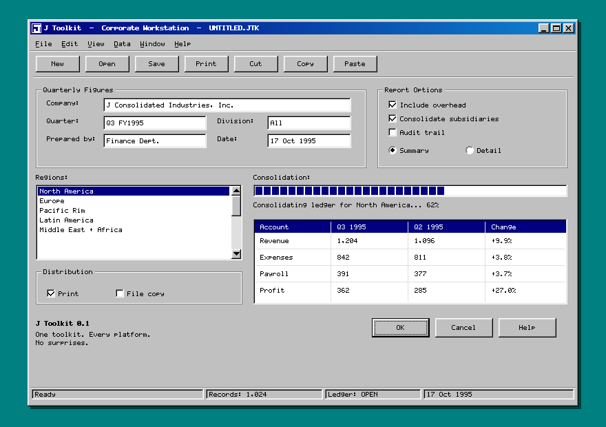

# J Toolkit



A cross-platform retro toolkit in **Rust**, reminiscent of **mid-90s
corporate design**: silver faces, two-pixel bevels, navy title bars,
segmented progress bars, and a status bar that tells you the ledger is
OPEN.

The **J** does not stand for anything. It is a nice looking glyph.

## Principles

* **No dependencies.** Not one. jt renders everything itself into an
  in-memory framebuffer with its own 5x7 bitmap font and its own PNG
  writer, so the same pixels come out on every platform.
* **Software rendering.** Widgets draw into a `Framebuffer`; a platform
  backend only opens a window, blits the buffer, and forwards clicks.
  Identical output on Windows, Linux, or anything with a rectangle of
  pixels to spare.
* **Period correct, within reason.** Raised and sunken bevels, dotted
  focus rectangles, etched group boxes, hotkey underlines, and a
  progress bar made of discrete navy blocks. No gradients — except the
  title bar, which had earned it by 1995.

## The widget set

Windows with gradient title bars and minimise/maximise/close furniture ·
menu bars · push buttons (normal / default / pushed / disabled) ·
labels · text fields · group boxes · checkboxes · radio buttons ·
list boxes · vertical scroll bars · segmented progress bars ·
multi-pane status bars · separators · and the J mark.

## Example

`example/` contains **jt-demo, "Corporate Workstation"** — a quarterly
report dialog for the fictional J Consolidated Industries, Inc.:

* `example/jt-demo.exe` — a Windows executable, built by CI on
  `windows-latest` (MSVC, statically linked CRT) and committed back to
  the repo by the workflow in `.github/workflows/build-example.yml`.
* `example/screenshot.png` — a screenshot of the example, produced by
  the executable itself: `jt-demo --screenshot screenshot.png`.
  The demo is interactive on Windows: click the checkboxes, radios,
  region list, and buttons.

## Using jt

```rust
use jt::{Framebuffer, Theme, widgets};

let theme = Theme::corporate();
let mut fb = Framebuffer::new(320, 200);
fb.clear(theme.desktop);
widgets::window(&mut fb, &theme, 10, 10, 300, 180, "J Toolkit", true);
widgets::button(&mut fb, &theme, 20, 160, 80, 23, "OK",
                widgets::ButtonState::Default);
```

## Building

```sh
# The library and the example (headless screenshot mode on any OS)
cargo build --release --manifest-path example/Cargo.toml
./example/target/release/jt-demo --screenshot screenshot.png

# Cross-compile the Windows example from Linux
rustup target add x86_64-pc-windows-gnu
# (needs a MinGW-w64 linker, e.g. apt install gcc-mingw-w64-x86-64)
cargo build --release --target x86_64-pc-windows-gnu \
    --manifest-path example/Cargo.toml
```

## Licence

MIT — see `LICENSE`.
